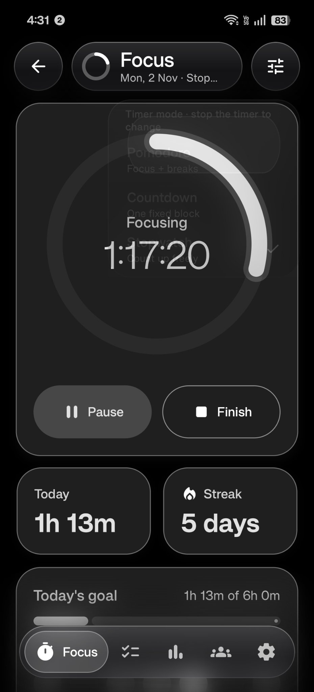
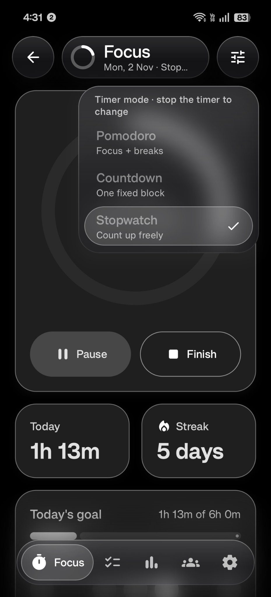
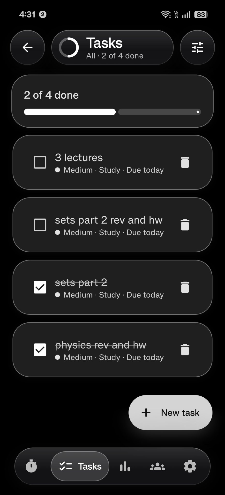
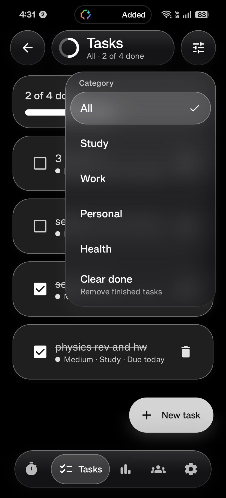
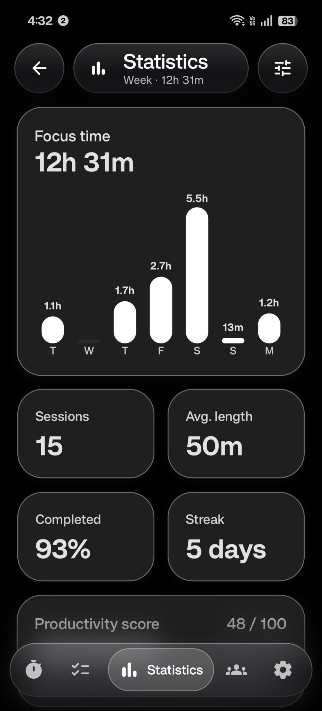
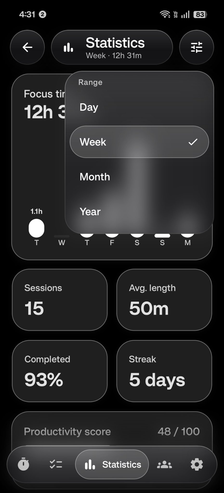
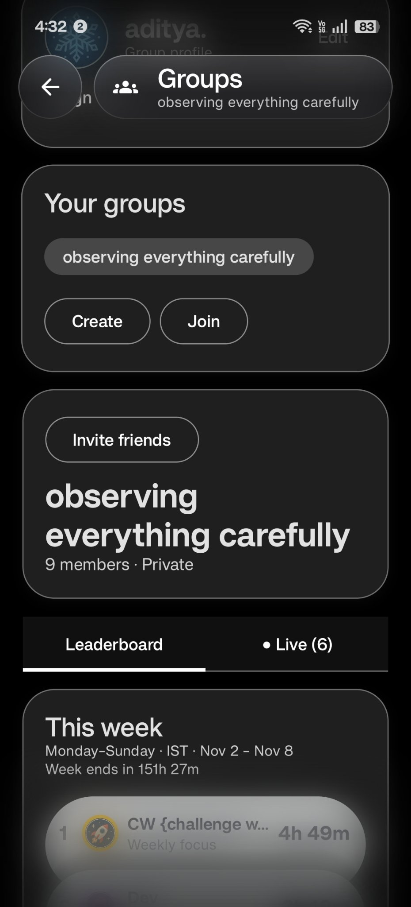
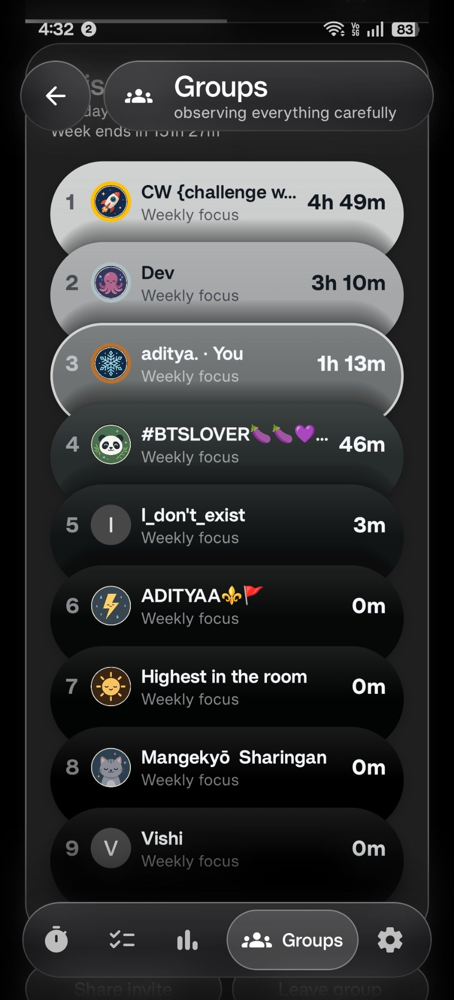
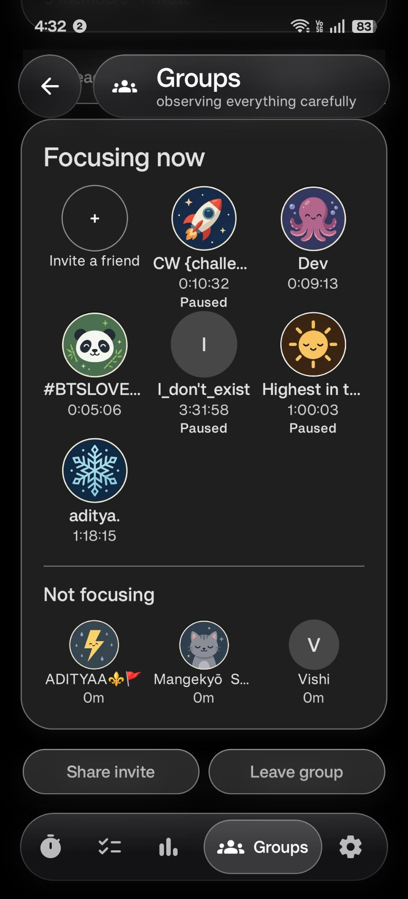

# Flowstate

A native Android focus app built with Kotlin, Jetpack Compose, Material 3, Hilt, Room and DataStore. This is the **Flowstate** project (`com.flowstate.focus`), not Stride.

## Screenshots

<table>
  <tr>
    <td align="center"><br>Focus</td>
    <td align="center"><br>Timer modes</td>
    <td align="center"><br>Tasks</td>
  </tr>
  <tr>
    <td align="center"><br>Task categories</td>
    <td align="center"><br>Statistics</td>
    <td align="center"><br>Statistics ranges</td>
  </tr>
  <tr>
    <td align="center"><br>Groups</td>
    <td align="center"><br>Leaderboard</td>
    <td align="center"><br>Live</td>
  </tr>
</table>

## 1.8.0: syllabus tracker (JEE, NEET, IAT)

- **Tasks | Syllabus.** A segmented toggle at the top of Tasks switches between your tasks and the syllabus tracker, and remembers the last tab. The top bar reads "Syllabus · JEE Main" with the exam's overall progress; its menu picks the exam (JEE Main, NEET, IAT), as do the chips under the toggle.
- **Bundled chapter lists.** `app/src/main/assets/syllabus.json` holds the official syllabi (JEE Main 2027: Physics 29, Chemistry 21, Mathematics 22; NEET UG 2027; IAT 2027) under NCERT chapter names. Parsed once by `SyllabusParser`.
- **Seven steps per chapter:** Chapter done, Rev 1–4, PYQs and Mocks. The overview shows an overall card (D-day from a matching exam on the Exams screen, revisions logged, source) and one card per subject with a ring, "Up next" and bars for how many chapters reached each step. A subject opens a screen with All / In progress / Not started filters and a tick row per chapter; tapping a chapter opens a sheet with the dated checklist, a PYQ sets counter (ticks itself at the target, 6 by default, tap the count to change it), a mocks counter, a note and **Focus on this**, which opens Focus with the chapter as the session's subject.
- **Revision suggestions:** Rev 1 three days after the chapter, Rev 2 seven days after Rev 1, Rev 3 fourteen after Rev 2, Rev 4 thirty after Rev 3 but no later than the day before the exam.
- **Shared chapters are ticked once across exams.** Progress is keyed by subject plus the normalised chapter name, not by exam, so a chapter that JEE, NEET and IAT all list (say Physics › System of Particles and Rotational Motion) is one record: tick it under JEE and it shows as done under NEET and IAT too. The chapter sheet says "Also in NEET · IAT".
- **Local only.** Progress lives in Room (database version 4, new table `syllabus_progress`, `MIGRATION_3_4`; sessions, tasks and exams are untouched). Nothing is uploaded: no Firestore or rules change. `MigrationSchemaTest` now checks 1→2→3→4 and 3→4 against the exported v4 schema.
- Session subjects can now be 60 characters (was 40) so the longest chapter names fit; the cloud already allows 80.
- **Windows app: Groups no longer empty themselves.** A Firestore `runQuery` answered with HTTP 200 can still carry an `{"error": …}` entry or be cut off; it used to be read as "no groups" and the list showed "No groups yet". Now an error entry, a truncated body or a nameless document fails the poll and the last good list stays; a non-empty list only empties after two empty polls in a row or a confirmed leave/delete. The groups poll survives any error and retries with backoff (5 s doubling to 5 min), requests retry once with a refreshed ID token on 401/403, and only a definitively revoked refresh token signs the PC out (other 4xx from the token endpoint no longer do).

## 1.7.2: bug fixes and this week's sessions

- **One notification, sounds that start in the background.** The ambient sounds no longer have their own foreground service. `TimerService` now hosts both the timer and the mix (`foregroundServiceType="specialUse|mediaPlayback"`), stays up while either is active and shows a single notification (timer line, sound status and a "Stop sounds" action). Before, Android 12+ refused to start the separate sound service when a Pomodoro focus block started by itself with the screen off, and a session showed two notifications.
- **Phases end on time with the screen off.** A phase-end alarm (`PhaseAlarm`, `setExactAndAllowWhileIdle`; `USE_EXACT_ALARM` on Android 13+, `SCHEDULE_EXACT_ALARM` up to 12) wakes the phone when a focus block or break ends. The coroutine timer alone runs on the monotonic clock, which stops in deep sleep, so alerts and the next phase could arrive minutes late. A phase is never finished early (a stale alarm just re-arms).
- **Dates roll over at midnight.** D-Day countdowns, the Focus subtitle, "Today", streaks, the daily-goal bar and Statistics follow the date (`data/time/Today.kt`) instead of the day the screen was opened.
- **Ambient audio hardening.** `RawSampleLoader` reads channels, rate and encoding from the decoder's output format, converts float PCM, cannot spin on a decoder that never signals end of stream, and returns null instead of throwing; a failed decode is retried. Recordings are prefetched when a sound is switched on, and asking for one allocates nothing on the audio thread. The audio thread rebuilds its `AudioTrack` if the audio server dies instead of spinning at full CPU.
- **Chat pushes retry.** The push request to the Worker retries twice (backoff, a fresh ID token on 401) and always closes its connection. The Worker answers a malformed token with 401 instead of 500 (redeploy `push-worker/worker.js` to pick that up; optional).
- **Room schemas are exported** to `app/schemas`, and `MigrationSchemaTest` checks migrations 1→2→3 against the exported v3 schema on the JVM.
- Lint: the Remote-timer card's ticking clock, per-call date formatters; internal Settings links show a chevron instead of the "opens in browser" icon.
- **New: Settings › Data › This week's sessions.** Monday to Sunday of the current week (local time), grouped by day with each day's total, newest first. Hold a session to delete it: same row, same confirmation and same delete path as the Focus screen's "Today's sessions" (`SessionDeleter`), so stats, streaks and the synced cloud copy update the same way.
- No Firestore rules change.

## 1.7.1: recorded rain, waves and café, plus crickets

- **Rain, Waves and Café are now real recordings**, and there is a new **Crickets** sound (night field), so the player has seven chips: Rain, Library, Brown noise, Café, Fireplace, Waves, Crickets. Library, Brown noise and Fireplace stay synthesised.
- The recordings are seamless loops in `app/src/main/res/raw/ambient_{rain,waves,cafe,crickets}.ogg` (48 kHz Ogg Vorbis, about 1.5 MB together): Waves 51.5 s stereo, Café 12.0 s stereo (cut on a whole number of beats of the music), Rain 12.5 s stereo, Crickets 50.7 s mono. Each loop's end is crossfaded into its start (equal-power, 2 to 3 s) and all are matched in loudness to the synthesised sounds.
- `SampleVoice` (in `service/ambient/AmbientSynth.kt`) plays them inside the same mixer as the synthesised voices, with the same per-block volume glide. A recording is decoded once (MediaExtractor + MediaCodec, `RawSampleLoader`) on a background thread the first time its sound is turned up, then kept in memory; it is silent for that moment and fades in.
- The saved mix is stored by sound name, so existing mixes keep working; Crickets starts off.
- Credits and licences for the recordings are in `NOTICE.md` (Pixabay Content License and Mixkit Sound Effects Free License). No Firestore rules change.

## 1.7.0: exam countdowns and ambient sounds

- **Exam countdowns.** A D-Day card on Focus (under the ambient player, above the Today/Streak tiles) shows "D-76 · Name" and the date. Swipe or tap it to step through the exams you chose; the pinned exam comes first, otherwise the nearest. Past exams drop off the card and show as **Done** on the Exams screen. The chevron opens a picker: tick which exams show on Focus, set each date with the Material date picker, pin one as main, rename or delete, add one, or open **All exams** (hero countdown with wavy progress, upcoming list, done list). The app starts with no exams. Stored in Room (database version 3, `MIGRATION_2_3` adds an `exams` table; earlier migrations unchanged). Local only, so there is **no Firestore rules change**.
- **Ambient sounds.** A player bar right under the timer card: play/pause, the mix name, sound chips (Rain, Library, Brown noise, Café, Fireplace, Waves) and a mixer sheet with per-sound and master volume, **Auto-pause on breaks** and **Follow the timer** (Off / With focus / 30 min). The mix is saved (DataStore `ambient`). Sound keeps playing with the screen off through the app's foreground service (since 1.7.2 the timer's `TimerService` hosts the sound too, with a "Stop sounds" action).
- **No audio files** (until 1.7.1, which replaced Rain, Waves and Café with recordings). Every sound was synthesised on the phone in real time (`service/ambient/AmbientSynth.kt`): filtered and modulated noise plus randomly timed events (fire crackles and pops, page turns, pencil strokes, distant footsteps). See `NOTICE.md`.

## 1.6.0: Flowstate for Windows, one-device timer, synced stats

- **Windows app** (`desktop/`, Compose Multiplatform for the JVM): Focus (Pomodoro, Countdown, Stopwatch, breaks, strict mode, "Still focusing?" check-ins), Stats, Tasks, Groups (leaderboard, live focus, group chat with replies and "Seen by") and Settings, in the same Slate glass look with a floating nav capsule and the daily-goal water bar. Sign in with the same email and password as on the phone. Phase ends show a Windows notification from the tray icon with a short chime; closing the window keeps Flowstate in the tray. App blocking stays phone-only: Windows has no equivalent of the Android focus guard.
- **The timer runs on one device at a time.** `users/{uid}/state/activeTimer` names the device running it. Open the PC while the phone is mid-session and the PC shows "Focus is running on your phone" with **Take over here** / **Keep on phone**; the phone shows the same card in reverse ("Running on your PC"). Taking over moves the session (phase, time left, subject, Pomodoro round) and the other device stops without double-counting it.
- **Stats sync** between phone and PC (`users/{uid}/sessions`). A session done on either device counts in both devices' history, daily goal, streak and group weekly/today totals. Existing local history is uploaded once on first sign-in. Deleting a session removes it everywhere. Signed out, everything stays local as before.
- The Android updater still takes the `.apk` from a release that also carries `Flowstate-<version>.msi`; the Windows app checks the same releases for a newer `.msi`.
- **Publish `firebase/firestore.rules` (1.6.0) to flowstate-241f0** before using the timer lock and sync; until then the Windows app shows a "publish the rules" message and the phone keeps working as in 1.5.0.

Build the Windows installer on Windows with `gradle :desktop:packageMsi` (JDK 17), or let the "Build Windows app" workflow attach it to the release. Run it locally with `gradle :desktop:run`.

## New in 1.1

- A Groups navigation tab, with email/password account creation, sign-in, password reset and sign-out.
- Private groups: create a room, join using a 12-character code, share an invite, switch groups and leave.
- A weekly leaderboard with bundled preset avatars or circular initials, rank, focus totals and a highlighted current-user row. Group weeks run Monday–Sunday in India Standard Time (IST, Asia/Kolkata), resetting at Monday 00:00 IST for every member.
- A Live tab inspired by the supplied references: focusing members in an avatar grid with elapsed timers, an invite tile, a separate “Not focusing” section and a shortcut to the existing focus timer. Stale presence is not presented as an ongoing live session.
- Editable profile names and a preset-avatar picker with Sprout, Sunbeam, Moon, Fox, Orbit, Summit, Cloud, Ember, Turtle, Jelly, Comet and Bloom. Avatar IDs are persisted in Firestore; artwork is bundled and initials remain available. No photo uploads or Firebase Storage.
- The supplied owl replaces the launcher and splash artwork. The pale outer border and corner decoration are removed. Adaptive icons use a separate full-bleed gray background and transparent owl artwork; legacy-density icons are also included.

## 1.4.4: emoji pings always arrive

Fixed: if the app was opened before the 1.4.3 rules were published, or the connection dropped, the emoji listener stopped for good and that person never saw incoming emojis. It now retries every 15 seconds and re-listens each time the app comes to the front.

## Emoji pings (1.4.3)

Open a friend's profile in a group by tapping them on the leaderboard or in the live room. Tap the round emoji button to the left of their avatar and pick one: 🔥 💪 👏 📚 🎯 ☕ 👀 😴. The next time they open Flowstate, it pops up over the app with a jelly bounce, showing who sent it and from which group. They can tap Nice to clear it, or Send one back. If you send again before they've seen it, the new emoji replaces the old one, so nobody gets spammed.

Settings › About now links to the source code on GitHub.

**Publish `firebase/firestore.rules` to flowstate-241f0 before using this.** The new `groups/{gid}/pings` rules only let members of the same group send pings, only allow the eight emojis, and only let the receiver read or clear one. Until you publish them, sending an emoji shows an error. No Cloud Functions are needed, so this works on the free Spark plan.

## Frosted top bar (1.4.2)

The big page titles are gone. Every tab now has a floating frosted top bar: a round back button, a pill with the screen's title and a one-line summary, and on Focus, Statistics and Tasks a round three-line button.

- **Focus**: the pill shows a ring for today's progress toward your daily goal. The menu holds Pomodoro, Countdown and Stopwatch, which replace the old mode chips. It's locked while a timer runs.
- **Statistics**: the menu holds Day, Week, Month and Year, which replace the segmented buttons.
- **Tasks**: the ring shows how much is done. The menu holds All and each category, plus Clear done.
- **Settings and Groups** get the back button and the pill only.

The menu is bouncy in the style of ColorOS. Slide a finger up and down it and a bubble springs after you, stretching like jelly as it moves and wobbling when it lands. The row under your finger swells and ticks, and pulling past the ends rubber-bands. Lift to choose, or just tap. Back goes to the previous tab, or leaves the app from the first one. The progressive blur now runs along the bottom edge too, under the nav bar.

## Frosted-glass navigation (1.4.1)

The floating bottom bar and the side rail are now frosted glass: content blurs behind them as it scrolls, with a soft tint, a top sheen and a thin bright rim. The selected tab is a translucent bubble with a light edge. Real blur needs Android 12+; older phones get a solid tint. The 1.4.0 avatar builder was removed, so avatars are back to the 24 presets. Any built avatar someone saved shows as their initial until they pick a preset. If you published the 1.4.0 Firestore rules, you can republish `firebase/firestore.rules`, but you don't have to.

## Open and build

Open this folder in Android Studio with JDK 17 or newer and an Android 35 SDK. Gradle 8.9 wrapper scripts and the wrapper JAR are included.

```sh
./gradlew :app:assembleDebug
./gradlew :app:testDebugUnitTest
```

On Windows, use `gradlew.bat`. Run on Android 8.0 / API 26 or newer. The debug APK is generated at `app/build/outputs/apk/debug/app-debug.apk` after a successful local build. For signed releases and in-place updates, follow [Update installation](UPDATE_INSTALLATION.md).

## Enable real groups

The supplied Flowstate Firebase client values are preserved unchanged. No Firebase project, account or backend deployment is created by this source update. The personal timer, tasks, statistics and settings remain local and work without cloud setup. The Groups page clearly explains when cloud configuration is missing; it does not show fake accounts or fake members.

Follow [Groups setup](firebase/GROUPS_SETUP.md): register `com.flowstate.focus` in your Flowstate Firebase project, enable Email/Password Authentication, create Firestore, fill `app/src/main/res/values/flowstate_firebase.xml`, and deploy the supplied Firestore rules. The app uses Firebase Authentication and Firestore only; no Storage bucket or Google Services Gradle plugin is needed. Cross-device sign-in and invites need internet access and the configured backend. Firebase service availability and quotas are managed in your own Firebase project.

See the setup guide for weekly-total accounting and device limitations. This is a focus-accountability app, not a tamper-proof competition; client-reported focus time is not independently verified by a server.

## Existing features preserved

Pomodoro, custom countdown and stopwatch timers; standalone breaks with a break-over notification; foreground-service chronometer notification; strict focus mode; Focus Guard; app blocking through the Accessibility Service; tasks with categories, priorities and deadlines; day/week/month/year statistics and charts; calendar heatmap, streaks and daily goals; theme, dynamic color, accent, Liquid UI and CSV export; floating navigation and tablet-friendly content width.

Enable app blocking in **Settings → Focus mode → App blocking service**, then grant the Accessibility permission. Notification permission is required on recent Android versions. Test background timers on real devices, especially manufacturers with aggressive battery restrictions.

## Before publishing

Configure release signing. Review the Accessibility Service disclosure and Play Console declaration, and the foreground-service `specialUse` justification. Test multi-user group operations against your own staging Firebase project before distributing a production build.

## Weekly leaderboard reset

Version **1.1.4** (Android version code **6**) adds hold-to-delete for past sessions, standalone breaks (5/10/15 min or custom) with a break-over notification, a group member profile sheet (weekly focus, league and rank, sessions, average), today's focus time in the Live tab, twelve more preset avatars (24 total), a 16-hour daily goal limit and a shared card depth effect. It hides Start focus while a focus block is running or paused and retires the Flow timer (old Flow sessions still show; a running Flow block resumes as a stopwatch). **Publish the 1.1.4 `firebase/firestore.rules`** so the new avatars and member stats are accepted; until then the app falls back to the 1.1.3 member payload and new-stat fields show "—".

Version **1.1.3** (Android version code **5**) moves the shared group leaderboard week to Monday–Sunday in India Standard Time (IST, Asia/Kolkata). The week and its countdown reset together at Monday 00:00 IST.

## Earlier avatar and visibility update

Version **1.1.2** (Android version code **4**) fixes avatar-save feedback, serializes avatar changes with background group publishing, and replaces old member snapshots to remove rule-incompatible legacy fields. The source already contained all twelve artwork mappings; this was not a missing-image issue. See [Update installation](UPDATE_INSTALLATION.md) to keep the existing signing key and local app data.

The included rules and Firebase CLI target are for project **`flowstate-241f0`**, database **`(default)`**. No live deployment was made. A new source build cannot make a six-avatar ruleset accept the new IDs; publish the twelve-avatar rules to the project actually used by the installed app. The fix reports that project's name and the denied write path.

## Accent-color picker restored

The six original accent presets remain Purple, Teal, Pink, Green, Blue and Orange. Settings now uses explicit 48dp color swatches in a wrapping layout, restoring the missing controls and keeping them reachable on narrow screens. Turn Dynamic color off to choose a preset on Android 12+; with Dynamic color on, wallpaper colors still take priority. Saved accent selection and light/dark contrast palettes are unchanged.

## In-app updates

Flowstate checks the latest GitHub Release on launch and shows an "Update available" pop-up when a newer version exists. Users tap **Update now**, the APK downloads inside the app, and Android's installer opens (the first time, Android asks them to allow installs from Flowstate).

To ship an update: bump `versionCode` and `versionName` in `app/build.gradle.kts` and push to `main`. The workflow builds the signed release APK and publishes a release tagged `v<versionName>` with the APK attached. Every release must be signed with the same keystore, or Android refuses to install it over the old one.

## Check-in

During a focus block, Flowstate asks "Still focusing?" after every 30 min, 1 hr, 1.5 hr, 2 hr or 3 hr of running focus time (1 hr by default), both in the app and as a notification with an **I'm here** button. If nobody answers within 2 minutes, the timer pauses itself, backdated to when the prompt appeared, so those minutes are never counted. Breaks get no check-ins, and a countdown shorter than the interval never sees one. It also pauses strict blocks, since being away isn't quitting. Turn it off in Settings under **Check-in**, where you also pick the interval.

## Side navigation (experimental)

Settings → Appearance → **Side navigation** swaps the floating bottom bar for a compact dock on the left edge: a slim pill of icons (the selected tab in a soft tinted circle) and, under it, a **daily-goal water bar**. The bar fills like a glass of water as today's focus adds up toward your daily goal, rising live while the timer runs, with ripples and bubbles. With Liquid UI on, it reads the phone's gravity sensor (gyroscope and accelerometer fused): tilt the phone and the water leans to stay level, overshoots and sloshes back. **Goal bar on top** swaps the two. The dock stays fixed in place (it never hides on scroll) and sits centred vertically, and screens keep a lane free on the left. Turn the switch off to get the original bottom bar back.

## Text that fits

Labels, buttons, tabs, stat tiles and leaderboard rows stay on one line and shrink to fit (or end in "…" for names) instead of breaking mid-word in narrow layouts or with a large system font. The focus timer ring is always a circle, and its clock scales with it.

## Top blur

Content that scrolls up under the status bar softens into a progressive blur, like the Hark app, so it never collides with the clock and icons. Real blur on Android 12 and newer; older phones get a tinted fade. The nav dock and bar stay sharp above it.

## Checking for updates

Settings → About → **Check for updates** asks GitHub for the latest release. If one is newer, the usual update card opens; otherwise it says you're on the latest version.

## Stacked leaderboard

The weekly leaderboard in Groups shows each member as an overlapping capsule. Its six shades are built from your accent colour, muted toward grey so they sit in the black-and-white UI: dark to pale on the light theme, pale fading into black on the dark theme, so rank 1 always has the most contrast. Text flips between light and dark per shade, your row gets an ink-coloured ring, and tapping a capsule opens that member's profile.

## Slate accent

The last swatch under Settings → Appearance → Accent color is **Slate**, built from #06141B, #11212D, #253745, #4A5C6A, #9BA8AB and #CCD0CF. It themes the whole app: buttons, the progress ring, chips, toggles and the nav bar use slate, cards get a faint cool tint, and the canvas stays near-white or true black. With Slate, the leaderboard uses those exact six shades.
